<p align="center">
  
</p>

# OpenVision · AI coding workspace

**Your projects. Your models. Your workflow.**

OpenVision is a desktop AI coding workspace combining a local
profile, project explorer, code editing, AI agents, Tab autocomplete, terminals,
Git and custom AI providers. Connect an OpenAI-compatible API or your own server
with a base URL, model name and API key. Discover models and choose reasoning
options without an OpenVision account.

**Development preview · Windows x64 and Linux x64 tested · macOS unverified**

[Get started](#get-started) · [Configure AI](#bring-your-own-ai) ·
[Prioritized feature roadmap](docs/planning/roadmap.md#ranked-rea-implementation-and-verification-work) ·
[Releases](https://github.com/RemiPelloux/OpenVision/releases) ·
[Documentation](docs/README.md) ·
[Repository layout](docs/engineering/repository-layout.md)

[Progress, percentages and gate-based ETA](docs/progress.md) ·
[Recovery coverage and missing layers](docs/recovery/recovery-status.md) ·
[Rust rewrite plan](docs/planning/rust/rust-roadmap.md)

**Source availability:** The full original source has not been recovered.
[`curs_source`](curs_source/README.md) contains actual readable application code,
extracted modules, native pseudocode and provenance, alongside OpenVision's own
customization source. Recovery versions and missing layers are documented there;
the archive is not an independently buildable original-source checkout.
The [source-to-gap map](docs/recovery/feature-gap-audit.md#source-index-to-implementation-gaps)
connects the versioned source index to implementation evidence and remaining
acceptance gates. All 237 selected JavaScript inputs have extraction results;
that count is separate from verified feature coverage.

> **Ready to run on Windows x64.** Download the complete portable app from
> [Releases](https://github.com/RemiPelloux/OpenVision/releases/tag/v0.2.0-preview.7),
> extract it, and double-click **OpenVision.cmd**. The complete app payload is
> also included in this Git repository. No separate editor, Node.js or npm setup.
>
> **Runs natively on Linux x64.** Build it locally from a pinned, checksum-verified
> input with `npm run prepare:desktop && npm start`, or package it with
> `npm run package:linux`. See the [Linux guide](docs/guides/linux.md).

## A workspace built around your choices

| Capability | What you can do today | Evidence and limits |
| --- | --- | --- |
| Custom AI providers | Save URLs and keys, discover models, add manual IDs, search grouped model lists | [Provider setup and persistence](docs/engineering/provider-selection-lifecycle.md) |
| Account models | Select signed-in Claude or eligible GPT-6 Codex accounts in Agent; inspect reported usage in the bottom bar | [Account setup and real test limits](docs/guides/account-integrations.md); experimental, included in preview.7 |
| Resource use | Release completed utility listeners, reuse unchanged account routes, bound failed-host retries and avoid duplicate stream retention | [Native cleanup](docs/engineering/utility-process-ownership.md) · [Request/heap measurements](docs/performance/account-performance.md); whole-app savings remain unmeasured |
| Project Home | Open projects in the current window, search recent work, pin favorites and resume saved workspaces | [Dashboard and measured scope](docs/guides/project-home.md); included in the portable app |
| Appearance | Choose dark, light or high-contrast themes and customize colors, fonts and icons | [Appearance guide](docs/guides/appearance.md) |
| AI Agent | Read files, propose edits and run approved tools through your selected provider | [Native and live-provider checks](docs/recovery/rea-agent-runtime.md); broader workflow coverage remains open |
| Code autocomplete | Select a separate completion model, accept with Tab, undo, cancel pending work | [Windows editing checks](docs/recovery/rea-custom-autocomplete.md); predictive navigation is unfinished |
| Project development | Explore projects, search, edit, Save All, run terminals/tasks and debug Node | [Development workflows](docs/engineering/development-workflows.md); one intermittent launcher-exit issue remains under investigation |
| Language tools | Bundled JavaScript/TypeScript tooling and optional pinned clangd for C/C++ | [Language checks](docs/recovery/rea-language-workflows.md) · [C/C++ setup](docs/guides/cpp-support.md) |
| Git and worktrees | Create branches/worktrees, review diffs, resolve conflicts and recover across restart | [Verified Windows scope](docs/engineering/git-workflows.md) |
| Local customization | Project rules, plans, skills, agents and MCP configuration under `.openvision/` | [Project configuration](docs/guides/project-configuration.md); some global paths still need auditing |
| MCP tools | Connect HTTP/STDIO servers, approve tool calls, cancel and reconnect | [Cleanup/session recovery](docs/recovery/rea-mcp-cleanup.md) and [window/user-data ownership](docs/recovery/rea-mcp-ownership.md) checks; broader profile/configuration ownership remains open |
| Approved memories | Review AI suggestions and legacy memories before saving project rules | [Memory guide](docs/guides/project-memories.md) |

The latest [source follow-up](docs/recovery/rea-agent-review-removal.md) keeps edit
review retryable after cancellation or cleanup failure. It requires a source
rebuild; the preview.7 portable download retains its published contents.

## Get started

**Download:** get **OpenVision-0.2.0-preview.7-win32-x64.zip** from
[the latest portable release](https://github.com/RemiPelloux/OpenVision/releases/tag/v0.2.0-preview.7).
Extract the ZIP and double-click **OpenVision.cmd**. Project Home brings together
recent projects, pinned favorites and open windows. Open a folder or saved
workspace, then configure your AI provider in **Models** settings.

**From Git:** clone the complete repository and double-click **Run-OpenVision.cmd**:

```sh
git clone --depth 1 https://github.com/RemiPelloux/OpenVision.git
cd OpenVision
```

The repository launcher verifies and extracts the included payload once, then
opens **OpenVision-portable/**. It uses built-in Windows tools only, preserves your
profile on later launches and makes no runtime downloads. GitHub's repository
ZIP works too. The package is approximately **327 MiB**; allow **2 GiB** free.

| System | Current support |
| --- | --- |
| Windows x64 | Complete portable download and repository payload; native package checks passed |
| Windows ARM64 | Native release package still planned |
| macOS Intel / Apple Silicon | Native release and desktop verification still planned |
| Linux x64 | Native local build and portable package; Wayland desktop suite, keyring and sandbox checks passed ([evidence](docs/verification/linux-verification.md)) |
| Linux ARM64 | Needs a pinned ARM64 input; not yet verified |

### Linux

```sh
git clone https://github.com/RemiPelloux/OpenVision.git
cd OpenVision
npm ci --prefix tooling
npm run prepare:desktop   # downloads the pinned Linux input and verifies its SHA-256
npm start                 # builds once, then opens Project Home
```

API keys use your desktop keyring (gnome-keyring, KWallet or KeePassXC) on any
desktop, including Hyprland, Sway and i3. `npm run package:linux` creates a
portable folder with an `./OpenVision` launcher and an optional launcher entry.
[Linux guide, requirements and capability differences →](docs/guides/linux.md)

[Installation, editable code and updates →](docs/guides/native-runtime.md) ·
[Models, imports and project customization →](docs/guides/user-guide.md)

## Bring your own AI

Explore [Codex Everywhere](https://codex-everywhere.com/home?aff=KTCCGGAS9R2Q)
through the project author's affiliate link.

Open **OpenVision Settings → Models & integrations → API connections**.

1. Choose **Add Provider**, **Add Codex Easy**, or **Add OpenAI**.
2. Enter the API base URL and your API key. Keep **Discover Models** selected.
3. Enable models, choose the active connection, and select a model in Agent.
4. Optionally choose a **Tab autocomplete model** separately; it starts Off.

| Provider | Example API base URL |
| --- | --- |
| Codex Easy | `https://codex-easy.ai/v1` |
| OpenAI | `https://api.openai.com/v1` |
| Your compatible local server | `http://127.0.0.1:8000/v1` |

Discovery uses `GET /models`; generation uses Chat Completions. API keys belong
in local secret storage, never in project files. Discovery alone does not prove
tools, reasoning, image input or completion compatibility.
For servers requiring extra authentication, use the masked **Additional Headers
(JSON)** field. Saved values use secret storage; an explicit Authorization header
overrides default Bearer authentication. [Header configuration and limits →](docs/engineering/provider-authentication-headers.md)

Reasoning choices are per model. **Provider default** omits an explicit effort;
other choices follow declared capabilities or labeled compatibility hints.
GPT, DeepSeek and Grok have separate [live verification results](docs/verification/live-provider-compatibility.md).
Not every displayed model or reasoning tier has passed a live test.

## Local profile, explicit connections

Preview.7 includes **Models & integrations**, optional first-launch
setup, and separate ChatGPT/Codex and Claude/Claude Code account profiles.
Use **Run setup again** in Settings to replay onboarding.
Choose **Add account**, complete browser sign-in, then select its model in the
existing **Agent** picker. Account groups show the returned email. OpenVision
continues to handle file tools and approvals; official panels are also available.
The bottom bar shows provider-reported account usage, or **Usage unavailable**.
Account controls include **Delete account**: isolated credentials and cache are
removed, while local conversation files are kept in an account history archive.
[Account sign-in, switching and current verification limits →](docs/guides/account-integrations.md)
These additions are included in preview.7; provider eligibility and verification
limits remain as documented.

Recent source verification also covers MCP session-expiry recovery, shared
connections across two project windows and isolation between separate user-data
profiles. See the [source verification summary](docs/verification/release-claims.md#source-additions-after-preview6)
for the exact scope and unresolved diagnostics. Updating Git does not replace
an already extracted portable app; install preview.7 into a fresh destination
using the [update guide](docs/guides/native-runtime.md#update-and-rollback).

The optional Node control plane also bounds STDIO response accumulation and
recovers after malformed output. Request admission is ordered with settings
saves to prevent stale connections after disable or replacement; see
[MCP lifecycle verification](docs/performance/control-plane-mcp-lifecycle.md).
See [validation and scoped RAM measurements](docs/performance/control-plane-stdio-resources.md);
these do not establish a whole-desktop RAM reduction.

**Real Windows checks:** on 16 October, saved Codex Easy `gpt-6.1-sol` completed
native multi-file editing, review, Undo/Redo and restart persistence
([live evidence](docs/recovery/rea-agent-live-edit.md)). Signed-in Claude read
and edited a test file on 15 October. Codex account choices include only GPT-6
models advertised by its official client; the tested account offered none and
rejected `gpt-6.1-sol`. Account eligibility is separate from API access, whose
earlier balance failure did not establish universal unavailability. Packaging
uses controlled local responses and does not repeat paid inference. Account
Agent support accepts text/tools; Tab autocomplete uses API connections.

- No OpenVision login or signup. Optional third-party coding-agent sign-in is
  separate from the local profile; original billing and hosted cloud-agent flows
  remain outside this project's scope.
- Built-in analytics and crash-upload implementations are disabled by the build.
  [Telemetry audit →](docs/recovery/rea-telemetry-audit.md)
- Configured AI providers receive the context needed for requests. MCP servers
  and independently installed extensions can also communicate externally.
- Large chat pastes become local UTF-8 files under `.openvision/paste/`, keeping
  prompts compact. [Paste behavior →](docs/recovery/rea-large-paste.md)
- Chat titles are generated locally, avoiding an extra AI request. Preview.7
  also skips hosted conversation-metadata watchers in local mode;
  [native restart checks](docs/engineering/local-conversation-metadata.md) preserve titles
  and history.

## Roadmap and honest progress

**21 of 44 acceptance stories fully verified · 47.73%.**
Another **11 are Partial**, **14 Planned** and **1 Unknown**. Partial stories
already contain working features; this score measures complete acceptance gates,
not the percentage of code implemented or decompiled. Since 18 October, Windows,
macOS, other-Linux and live-provider clauses are tracked in dedicated platform/live
stories, and other stories are judged on Linux x64
([re-scope](docs/planning/eta-and-definition-of-done.md#re-scope-baseline-v3)).

The next product target is **36/44 verified stories (at least 80%)**. All worker
branches are merged into `main` (clean build, 13 unit suites passing). The
[status page](docs/planning/eta-and-definition-of-done.md) lists every remaining story
with its gap, its gate (Linux work, owner decision or external machine/balance) and the
ETA: about 3 more worker rounds for the Linux work, with a Linux ceiling of 39/44. Owner
decisions are tracked in [#5](https://github.com/RemiPelloux/OpenVision/issues/5); the
Windows, macOS, other-Linux and live-provider stories in issues #1–#4.

The [feature roadmap](docs/planning/roadmap.md) covers every unfinished story using
**complexity points, dependencies and acceptance gates**.
The [critical-first queue and ETA](docs/planning/roadmap.md#critical-first-backlog-and-eta)
orders **36 unfinished stories / 322 provisional points**: safety and privacy,
RAM/request efficiency and daily workflows, independent builds, retrieval,
distribution/platform completion, then broader modes. Estimates describe scope;
release readiness requires the named checks. Latest source work includes
[edit-review recovery](docs/recovery/rea-agent-review-recovery.md#created-review-snapshot-ownership)
and [storage ownership for discovered models](docs/engineering/storage-write-ownership.md).
[Native Undo/Redo failure recovery](docs/recovery/rea-agent-undo-retry.md) now
retains retryable history entries and shows guidance after snapshot-service failures.
Preview.7 packages these fixes and recent performance changes. The
[release notes](docs/releases/0.2.0-preview.7.md) and
[package verification](docs/verification/portable-preview7.md) distinguish working
flows, controlled checks and remaining gates. No whole-app speedup is claimed.

The [Rust rewrite roadmap](docs/planning/rust/rust-roadmap.md) breaks the architecture track into
**36 planned packages / 195 provisional points**, with dependencies, migration,
rollback and release gates. The [component audit](docs/planning/rust/rust-component-audit.md)
identifies what moves to Rust, what stays external and the compatibility risks.
The [gain and measurement plan](docs/planning/rust/rust-performance-plan.md) separates expected
benefits from evidence: replacing the desktop shell is the largest structural
RAM opportunity, while remote inference and retained tools keep their own costs.
The rewrite is planned; no Rust speedup or RAM reduction is measured yet.
The [42-story replacement map](docs/planning/rust/rust-acceptance-map.md) tracks required feature
coverage, and [migration contracts](docs/planning/rust/rust-migration-contracts.md) define code
ownership, single-writer data transfer and safe rollback. The plan compares
native and webview desktop options before choosing a toolkit.

## Develop and verify locally

```sh
npm run check:desktop
npm run test:accounts
npm run test:portable
npm run test:completion
npm run verify:completion -- --editing --portable ./OpenVision-portable
npm run verify:welcome -- --portable ./OpenVision-portable
npm run verify:mcp-session
npm run verify:mcp-ownership
npm run verify:mcp-config-ownership
npm run test:agent-review
npm run verify:agent
npm run status:features
```

On Linux, the same native verifiers run against the local build, plus
`npm run verify:linux-secrets` for keyring selection. See
[Linux verification](docs/verification/linux-verification.md).

Development tooling uses **Node.js 24.18.0** and `npm ci --prefix tooling`.
The desktop build validates generated scripts, manifests and local main-process
imports. See [build integrity and verification limits](docs/engineering/runtime-build-integrity.md)
for the latest recovery and shutdown corrections.

The source build also rejects stale search initialization after project changes
or disposal. See the [retrieval audit and verification limits](docs/recovery/rea-retrieval-ownership.md)
for the reproduced race, native project regression and remaining indexing gates.

The [Agent review audit](docs/recovery/rea-agent-edit-history.md) tracks native project
search, multi-file acceptance and editor undo. `verify:agent` uses a local model
fixture with real application tools; live-provider evidence is reported separately.
Add `-- --review-recovery` to check repeated edits and pending review across
normal restarts, or `-- --review-abrupt` to verify rejection/acceptance recovery
after abrupt app exits; see [review recovery](docs/recovery/rea-agent-review-recovery.md)
for the exact Windows evidence and remaining failure cases.

The [Agent retry fix](docs/recovery/rea-agent-retry-history.md) prevents failed requests
from adding an empty assistant reply to subsequent history. The opt-in
`npm run verify:agent:live -- --live --model deepseek-v4-flash --retry-auth`
checks real authentication failure and manual recovery through the configured
provider; it consumes API quota and uses a disposable project.

The portable package contains editable code under
`electron-host/resources/app/` and helpers under `electron-host/desktop/`;
changes there load after restarting. Full native-source rebuilds remain planned.
Native checks use disposable profiles. Live-provider
checks are opt-in and consume API quota. **GitHub Actions is disabled**; this
project does not require paid CI to build or verify changes.

| Directory | Responsibility |
| --- | --- |
| `desktop/` | Durable customization code, adapters and verification tools |
| `scripts/recovery/` | Offline recovery workflows and published-archive verification |
| `examples/` | Small projects for trying development workflows |
| `assets/` | Original OpenVision SVG identity and animated README banner |
| `docs/` | Setup, feature evidence, recovery boundaries and roadmap |
| `tooling/` | Locked build and verification dependencies |
| `downloads/windows-x64/` | Complete portable payload in SHA-256-verified Git parts |
| `Install-OpenVision.ps1`, `Run-OpenVision.cmd` | Offline extraction and launch |
| `source/`, `electron-host/` | Generated local runtime; excluded from Git |
| `data/`, `backups/`, `logs/` | Private local state and evidence; excluded from Git |

[Contributing](CONTRIBUTING.md) · [Security](SECURITY.md) ·
[Changelog](CHANGELOG.md) · [Install and update](docs/guides/native-runtime.md)

Third-party notices are included in the portable app. See [licensing scope](NOTICE.md).
OpenVision is an independent project; this preview has unfinished acceptance gates.
