<p align="center">
  
</p>

<p align="center">
  <a href="https://github.com/RemiPelloux/OpenVision/releases/tag/v0.2.0-preview.7"></a>
  <a href="docs/planning/eta-and-definition-of-done.md"></a>
  
  
  <a href="https://remipelloux.github.io/OpenVision/"></a>
</p>

<p align="center">
  <b>An AI coding workspace that runs on your machine, with the models you choose.</b><br>
  Agent · Tab completion · MCP tools · Git · terminals — no OpenVision account, no telemetry.
</p>

<p align="center">
  <a href="#quick-start">Quick start</a> ·
  <a href="#bring-your-own-ai">Bring your own AI</a> ·
  <a href="https://remipelloux.github.io/OpenVision/">Documentation</a> ·
  <a href="#status">Status</a> ·
  <a href="#build-from-source">Build from source</a> ·
  <a href="https://github.com/RemiPelloux/OpenVision/releases">Releases</a>
</p>

---

## Why OpenVision

<table>
<tr>
<td width="50%" valign="top">

### 🔑 Your models, your keys
Connect any **OpenAI-compatible API**, your own server or a **local model** with a
base URL and a key. Models are discovered automatically; keys live in your OS keyring,
never in project files.

</td>
<td width="50%" valign="top">

### 🤖 An Agent that asks first
The Agent reads your project, proposes multi-file edits you review and undo, and runs
tools only after approval. Stop, retry and restart are covered by native tests.

</td>
</tr>
<tr>
<td valign="top">

### ⚡ Tab completion on your terms
Pick a separate completion model, accept with Tab, undo, cancel. Completion is off
until you choose a model.

</td>
<td valign="top">

### 🧩 MCP, rules and memories
Connect HTTP and STDIO MCP servers with OAuth, keep project rules, skills and agents
under `.openvision/`, and approve memories before they are saved.

</td>
</tr>
<tr>
<td valign="top">

### 🛡️ Local by default
A local profile with no sign-up. Built-in analytics and crash upload are disabled by
the build, and captures show project data going only to the providers you configure.

</td>
<td valign="top">

### 🔎 Search, Git and remote
Local code search, Git and worktrees, terminals and debugging, Project Home, and
SSH remote windows to Linux hosts.

</td>
</tr>
</table>

<p align="center">
  
</p>

## Quick start

<details open>
<summary><b>Windows x64 — portable download</b></summary>

1. Download **OpenVision-0.2.0-preview.7-win32-x64.zip** from
   [the preview.7 release](https://github.com/RemiPelloux/OpenVision/releases/tag/v0.2.0-preview.7).
2. Extract it and double-click **OpenVision.cmd**. No Node.js or separate editor needed.

The same payload is in this repository: clone it and double-click **Run-OpenVision.cmd**,
which verifies and extracts it once (about 327 MiB; allow 2 GiB free).

</details>

<details open>
<summary><b>Linux x64 — build locally</b></summary>

```sh
git clone https://github.com/RemiPelloux/OpenVision.git && cd OpenVision
npm ci --prefix tooling
npm run prepare:desktop   # downloads the pinned input and verifies its SHA-256
npm start                 # builds once, then opens Project Home
```

Keys use your desktop keyring (gnome-keyring, KWallet or KeePassXC), on any desktop
including Hyprland, Sway and i3. `npm run package:linux` creates a portable folder.
See the [Linux guide](docs/guides/linux.md).

</details>

> [!NOTE]
> preview.7 predates the October fixes. They are in the source today and will ship in
> **0.2.0-preview.8**, the release candidate of the [next sprint](docs/planning/next-sprint.md).

## Bring your own AI

Open **Settings → Models & integrations → API connections**, choose **Add Provider**,
enter a base URL and key, keep **Discover Models** on, then pick a model in the Agent.

| Provider | Base URL |
| --- | --- |
| OpenAI | `https://api.openai.com/v1` |
| Codex Easy | `https://codex-easy.ai/v1` |
| Your server or local model | `http://127.0.0.1:8000/v1` |

Discovery uses `GET /models`; generation uses Chat Completions. Reasoning options
follow each model's declared capabilities, and extra headers are stored as secrets.
Discovery alone does not prove tool, image or reasoning support — see
[live provider results](docs/verification/live-provider-compatibility.md).
Optional ChatGPT/Codex and Claude account sign-in is separate from the local profile
([accounts guide](docs/guides/account-integrations.md)).

<sub>The author's affiliate link: [Codex Everywhere](https://codex-everywhere.com/home?aff=KTCCGGAS9R2Q).</sub>

## Status

**36 of 44 acceptance stories are fully verified (81.8 %)** — every story that Linux x64
can close without a GPU reference machine, other hardware or a release gate.

| Platform | State |
| --- | --- |
| Linux x64 | Native build and portable package; critical suite 11/11 on X11, Wayland smoke |
| Windows x64 | Portable preview.7 download; October fixes not yet re-verified ([sprint Track A](docs/planning/next-sprint.md#track-a--windows-x64-ov-901)) |
| Other Linux, ARM64 | Planned ([#3](https://github.com/RemiPelloux/OpenVision/issues/3)) |
| macOS | Unverified; packaging not started ([#2](https://github.com/RemiPelloux/OpenVision/issues/2)) |

25 October Windows follow-up: the existing recovered runtime rebuilds again;
rename validation has bounded filesystem concurrency and native conflict/Undo
checks. [Scoped evidence](docs/recovery/rea-windows-rename-upgrade.md); the full
Windows gate stays open and preview.7 is unchanged.

The score counts complete acceptance gates, not lines of code. The
[status page](docs/planning/eta-and-definition-of-done.md) lists the 8 remaining
stories, their gates and the Definition of Done; the
[next sprint](docs/planning/next-sprint.md) validates Windows first, runs the
GPU reference budgets and ships preview.8.

## Build from source

```sh
npm ci --prefix tooling
npm run prepare:desktop
npm run build:desktop          # clean build ~460 s cold, ~130 s with a warm build cache
npm run test:desktop           # unit suites
npm run verify:critical        # native critical suite (Linux: under xvfb-run + dbus-run-session)
npm run status:features        # recompute the verified-story count
```

- **Node.js 24.18.0.** The build runs with a 6 GiB V8 heap.
- **Build cache.** Customized bundles are kept in `build/cache` (zstd); a clean rebuild
  with unchanged code restores them byte-identically. `OPENVISION_NO_BUILD_CACHE=1`
  forces every transform.
- **Releases.** `npm run release:linux` produces a reproducible `.tar.zst` archive and a
  signed manifest; [build performance](docs/performance/build-performance.md) has the numbers.
- **No hosted CI.** GitHub Actions is disabled; every check runs locally.

<details>
<summary><b>Repository layout</b></summary>

| Path | Contents |
| --- | --- |
| `desktop/` | Build customizations, adapters and native verifiers |
| `docs/` | Guides, engineering notes, verification evidence, planning — also the [documentation site](https://remipelloux.github.io/OpenVision/) |
| `curs_source/` | Recovered reference code and provenance (see below) |
| `scripts/` | Recovery workflows and helper scripts |
| `tooling/` | Locked build and verification dependencies |
| `assets/` | OpenVision identity and animated artwork |
| `downloads/windows-x64/` | Complete Windows portable payload in SHA-256-verified parts |
| `examples/` | Small projects for trying workflows |
| `source/`, `electron-host/`, `build/` | Generated locally; not in Git |
| `data/`, `backups/`, `logs/` | Private local state and evidence; not in Git |

</details>

<details>
<summary><b>About the source</b></summary>

OpenVision builds on a recovered desktop application. The full original source has
not been recovered: [`curs_source`](curs_source/README.md) holds readable application
code, extracted modules, native pseudocode and provenance next to OpenVision's own
customization source, and is not an independently buildable original checkout. Native
hosts, addons and WASM remain compiled implementations. See
[recovery status](docs/recovery/recovery-status.md) and the
[licensing notice](NOTICE.md); an independent build (OV-804) awaits an owner and legal
decision.

</details>

## Contributing and security

Read [CONTRIBUTING.md](CONTRIBUTING.md) before opening a change and
[SECURITY.md](SECURITY.md) to report a vulnerability privately. Release history is in
the [changelog](CHANGELOG.md) and [release notes](docs/releases/README.md).

<sub>OpenVision is an independent project and a development preview with unfinished
acceptance gates. No project-wide license has been selected; third-party software keeps
its own terms — see [NOTICE.md](NOTICE.md).</sub>
