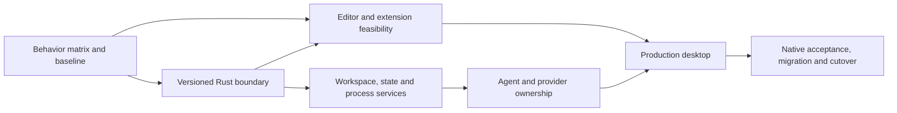

# OpenVision Rust rewrite roadmap

[Product progress, percentages and gate-based ETA](../../progress.md) ·
[Current feature priorities](../roadmap.md#ranked-rea-implementation-and-verification-work) ·
[Recovery coverage](../../recovery/recovery-status.md)

**Planning audit: 15 October 2026 · no Rust implementation or Rust performance result shipped.**
Source reference: `a9ebd69691b5eed10c702d3dd6b9014814bdca5a`.

The recommended destination is an owned Rust core and desktop shell, with proven
external tools retained behind explicit interfaces. Migrate services incrementally
in the working app, then replace the shell once the editor and extension prototype
passes. A sidecar alone does not complete the rewrite. No UI toolkit is selected yet.

Read the [component audit](rust-component-audit.md) for each rewrite/retain decision
and the [measurement plan](rust-performance-plan.md) for expected gains and their
proof. This is an implementation roadmap, not a claim of recovered original source
or full feature equivalence.

The [42-story acceptance map](rust-acceptance-map.md) assigns every current feature
contract to its replacement packages. The [migration contracts](rust-migration-contracts.md)
define ownership transfers, data compatibility, proposed code boundaries and stop
conditions. Together these five documents form the rewrite plan; none records a
completed Rust implementation.

## Decision summary

**Proceed incrementally; prove the editor and extension boundary before committing
to the production shell.** Rewriting all dependencies would add risk without
establishing a faster OpenVision. The recommendation is a Rust-owned product with
explicit external engines and an isolated compatibility host where required.

| Product area | Final disposition | Gain opportunity | Main cost or risk |
| --- | --- | --- | --- |
| Workspace, search orchestration and retrieval | Rust services | Less duplicate scanning, fewer copies, bounded index memory | Freshness and retrieval quality must match |
| Profiles, history, rules and secrets | Rust storage owner with SQLite/OS adapters | Paged history, bounded caches, reliable concurrent writes | Migration and recovery must preserve exact data |
| Agent, providers, completion and Quick Edit | Rust execution/state owner | Less local overhead, duplicate context and abandoned work | Tool approvals, streaming, retry and undo compatibility |
| Project home, settings, model picker and editor | Rebuilt desktop UI after feasibility gate | Visible-row rendering; removing the old shell can reduce base RAM | Text input, accessibility and extension compatibility dominate scope |
| Git, ripgrep, SQLite, LSP/DAP, shells and official account clients | Retain; Rust adapters and supervision | Fewer redundant launches and better idle release | Their memory and remote inference costs remain |
| Existing assembly/transformation pipeline | Retire after independent-build cutover | Owned, reproducible release with fewer runtime prerequisites | Clean builds, installers, update rollback and native platform checks |

The [performance plan](rust-performance-plan.md#when-gains-can-arrive) separates
gains available in the first service preview from gains that require the new
desktop. No measured saving or rewrite percentage is available yet.

### Architecture choices to validate

| Approach | What moves | Resource opportunity | Decision |
| --- | --- | --- | --- |
| Rust core with existing desktop | Services first; existing editor and extensions stay | Targeted CPU/queue/cache improvements; temporary bridge can add RAM | Recommended migration path, subject to per-service proof |
| Rust core with system-webview UI | Core and shell lifecycle; web editor/UI remain | Can remove bundled Chromium distribution; OS webviews and JS still consume memory | Feasibility candidate; measure full app and compatibility |
| Rust core with native Rust UI/editor | Core, shell and editor; explicit external/extension hosts remain | Broadest control of idle memory, rendering and copying | Preferred destination only if editor/accessibility/extension gates pass |
| Replace every subsystem at once | Product, editor, integrations and migration change together | No gain can be attributed until a usable replacement exists | Reject as the execution plan; loses incremental parity and rollback |

Framework names are not acceptance evidence. RUST-07 must compare concrete native
and webview candidates against the same editor fixture before selecting one.
Keep the existing simple appearance, theme customization and keyboard behavior;
the rewrite does not require a visual redesign.

## Scope and completion

The rewrite includes project management, editing, search, local intelligence,
Agent, autocomplete, Quick Edit, provider/account orchestration, local state,
terminal/debug/task integration, settings, themes, onboarding and distribution.
Preserve the current local-profile product, `.openvision` project metadata,
custom URLs/keys/models, supported official sign-in flows and approval controls.
Hosted OpenVision accounts, cloud agents and hosted collaboration stay excluded.

Completion requires all of the following:

- Owned Rust implementations of the app core and production shell/editor.
- An explicit supported capability matrix, including extension APIs, webviews,
  language servers, debuggers, terminals, accessibility and platform differences.
- A clean build from versioned source and declared dependency inputs, without
  recovered app bundles, the old executable, native addons of unknown provenance
  or bundle-patching steps on the production path.
- Verified profile/history/secret migration, crash recovery and rollback.
- Same-workload parity and measured resource improvements across the declared
  supported platforms. Document every external runtime still required.

Rust does not rewrite Git, SQLite, language servers, third-party extensions or
official account clients. Their presence is compatible with a Rust-owned app;
their processes and costs must still appear in benchmarks and the dependency list.
Required compatibility cannot be silently dropped to make the rewrite look done.

## Architecture and migration boundaries

Initially, the existing UI calls a Rust core over a local, versioned transport.
Later, a Rust desktop shell uses the same domain contracts. Keep one coherent core
with bounded worker pools; create separate processes only for trust, crash or
external runtime isolation. Avoid a process per feature or project by default.

| Owner | Responsibilities | Boundary |
| --- | --- | --- |
| Rust domain/core | Document/workspace identity, edits, state, jobs, Agent state machine and approvals | Typed commands/events independent of UI or provider SDK |
| Rust adapters | Files, OS secrets, Git, PTY, network, MCP/LSP/DAP and official clients | Parse once; retain source identity, capability and error details |
| Desktop shell | Input, view state, visible rows, accessibility, editor painting and themes | Incremental document changes and bounded event batches |
| Isolated compatibility host | Required JavaScript extensions and supported webviews | Explicit API subset, permissions, lifecycle and resource accounting |
| External tools | Language servers, debuggers, shells, provider clients and optional REA | Supervised processes/protocols; their own implementations remain external |

Transport must authenticate the local caller, bound messages before allocation,
propagate cancellation to actual I/O and return structured errors. A command
finishing late must not mutate a newer document, account or project generation.
Use document versions and workspace/account/session IDs; never send whole projects
or full documents on every keystroke. Negotiated framing and schema versions must
support rolling back one subsystem without ambiguous state ownership.

Move one owner at a time. Select either the old or Rust writer for each store;
avoid two live writers and overlapping watchers. Begin with read-only comparison
using disposable fixtures, then opt-in use, then default use. Never duplicate paid
inference, approvals or filesystem mutations for shadow comparisons. Rollback is
a controlled service switch or restart when needed; profile backups remain usable.

## Priorities and point accounting

Points use the [shared complexity scale](../roadmap.md#points-and-delivery-gates),
not calendar time. The former **99-point outline is superseded** by the
**195-point planning baseline below: 36 child packages under RUST-01–09**.
Parent totals are summaries, never additional work. All children are **Planned**.
Implementation stories and test fixtures are produced at each entry gate.

This is not a fixed estimate of every unknown. The required extension API
surface, native editor/toolkit feasibility, retrieval replacement and platform
failures may expand it. RUST-01 and RUST-07 must re-estimate the affected children
before committing to production scope. No defensible rewrite percentage exists
until the capability matrix is pinned and its gates are executed.

The existing **42-story / 322 remaining-point** feature backlog remains separate.
Do not add these 195 points to it: contracts, tests and replacements can overlap.
Current acceptance credit still comes only from the existing story gates.

| Priority | Parent package | Points | Entry condition |
| --- | --- | ---: | --- |
| P0 | RUST-01 · contracts and baseline | 8 | Current source and evidence pinned |
| P0 | RUST-02 · core boundary and rollback | 14 | RUST-01 contracts for the first service |
| P0 decision | RUST-07 · editor/shell/extension feasibility | 18 | RUST-01 matrix; RUST-02 boundary for integration |
| P1 | RUST-03 · workspace, search and retrieval | 23 | RUST-02; relevant OV-501–504 contracts |
| P1 | RUST-04 · profiles, history and secrets | 13 | RUST-02; OV-301/302/701 data contracts |
| P1 | RUST-06 · process and protocol ownership | 23 | RUST-02; OV-303/304/402/403/703 contracts |
| P2 | RUST-05 · Agent, providers and AI editing | 31 | RUST-02/04 and process interfaces from RUST-06 |
| P3 | RUST-08 · production editor and desktop shell | 45 | RUST-07 go decision; service contracts ready per slice |
| P4 | RUST-09 · independent release and cutover | 20 | RUST-08 and all declared release gates |
| | **Total: children counted once** | **195** | Unknown scope is re-estimated at decision gates |

Safety and data integrity outrank throughput. RUST-03/04/06 and RUST-07 exploration
can proceed independently after the shared boundaries stabilize. Account UI can
be prototyped early; its production state owner must be ready first. Investigate
Rust now without waiting for every old backlog story, but production replacements
must satisfy the affected behavior contracts and release gates.

## Implementation packages and user outcomes

Each row supplies the observable result and exit evidence. A 13-point production
shell package has been split; remaining 8-point rows need smaller coding tasks
after their contracts are pinned.

### RUST-01 · establish what must work · 8 points

| ID | Points | User outcome and acceptance evidence |
| --- | ---: | --- |
| RUST-01a | 3 | Keep required workflows: pin the 42-story mapping plus an explicit extension/API/platform matrix; label unsupported and unknown capabilities |
| RUST-01b | 3 | Compare fairly: run current optimized-build cold/warm and long-session workloads; record process-family memory, CPU, latency, requests and input digests |
| RUST-01c | 2 | Keep user data: document schema/secret ownership, migration fixtures, failure injection, compatibility risks and release stop conditions |

### RUST-02 · integrate without breaking the working app · 14 points

| ID | Points | User outcome and acceptance evidence |
| --- | ---: | --- |
| RUST-02a | 3 | Build an owned Rust workspace with pinned toolchain/dependencies, named contracts, typed errors and a local reproducible test harness |
| RUST-02b | 5 | Call a real core service: versioned local transport, bounded framing, incremental events, caller checks, cancellation and backpressure pass integration tests |
| RUST-02c | 3 | Recover from failure: service crash, hung child, stale response and app shutdown release or retain cleanup ownership correctly |
| RUST-02d | 3 | Roll back safely: per-service selection and single-writer handoff work against disposable profiles; no duplicate mutation or inference |

### RUST-03 · explore and search large projects efficiently · 23 points

| ID | Points | User outcome and acceptance evidence |
| --- | ---: | --- |
| RUST-03a | 5 | Open multi-root projects incrementally: paged Explorer, ignore/symlink/case rules and incremental watchers survive rename/delete/overflow/branch changes |
| RUST-03b | 5 | Search without repeated scans: supervise pinned ripgrep, stream/cancel results and share versioned file facts; reference query results match |
| RUST-03c | 8 | Retrieve relevant context: own chunk/index/ranking contracts, reuse proven parsers and persist rebuildable indexes; quality, freshness and network destinations pass fixtures |
| RUST-03d | 5 | Stay bounded: deduplicate work, apply byte/concurrency budgets and demand-driven startup; close/reopen and malformed/huge projects pass resource checks |

### RUST-04 · preserve local profiles and history · 13 points

| ID | Points | User outcome and acceptance evidence |
| --- | ---: | --- |
| RUST-04a | 5 | Keep settings, projects, rules, memories, plans and paste attachments through transactional, backed-up migration; concurrent windows cannot lose writes |
| RUST-04b | 5 | Reopen long chats without eager loading: paged durable history, versioned edit/checkpoint state and recoverable schema changes preserve replay and undo contracts |
| RUST-04c | 3 | Isolate accounts: OS secret adapters and account/cache deletion preserve history; locked/unavailable keyring, interrupted cleanup and restart pass platform fixtures |

### RUST-05 · run Agent and AI editing with one resource owner · 31 points

| ID | Points | User outcome and acceptance evidence |
| --- | ---: | --- |
| RUST-05a | 8 | Use custom providers: URL/key/model identity, discovery, reasoning capabilities, streaming/tool events, bounded errors and explicit retries preserve routing |
| RUST-05b | 8 | Run Agent: own context selection, tool scheduling, approvals, subagent budgets, edit review, checkpoints and session replay; Stop cancels actual work |
| RUST-05c | 5 | Get Tab and Quick Edit: debounce before snapshots, send versioned deltas/context, reject stale edits and preserve accept/undo; no request per intermediate keystroke |
| RUST-05d | 5 | Use Codex/Claude accounts: retain official clients, supported browser/callback login, isolated switch/delete, capability catalog and honest usage/limit status |
| RUST-05e | 5 | Avoid hidden cost: local titles, request-scoped deduplication, context budgets, bounded retained reasoning/tool state and idle release pass long-session tests |

Reasoning and tool-call data needed by retries or branches cannot be evicted by an
arbitrary LRU. Transfer it to durable session ownership and test replay before
releasing resident data. Different providers keep their own capability semantics.

### RUST-06 · own children and protocol lifetimes · 23 points

| ID | Points | User outcome and acceptance evidence |
| --- | ---: | --- |
| RUST-06a | 5 | Stop owned work safely: process identity, bounded diagnostics, pipe draining, descendant cleanup and failed-cleanup retry survive cancellation/crashes |
| RUST-06b | 8 | Use terminals and tasks: PTY/ConPTY adapters, resize, Unicode, shell quoting, exit/Ctrl+C and approved commands pass native OS fixtures |
| RUST-06c | 5 | Keep language/debug support: LSP/DAP routing, diagnostics, incremental sync, breakpoints and restart work with retained servers/adapters |
| RUST-06d | 5 | Use MCP and optional REA: preserve chosen transports/tools, cancel timed-out I/O, lazy-connect and reconcile sessions; retain REA as an external boundary |

### RUST-07 · decide the desktop architecture early · 18 points

| ID | Points | User outcome and acceptance evidence |
| --- | ---: | --- |
| RUST-07a | 5 | Compare a native Rust UI and a system-webview candidate with the same project/editor workload; publish dependency, accessibility, memory and IPC findings |
| RUST-07b | 8 | Prove editor viability: text storage, large files, syntax, multi-cursor, Unicode/IME, selection, undo, diff, keyboard navigation, screen reader and high-DPI fixtures |
| RUST-07c | 5 | Prove compatibility: run representative extensions, language/debug integrations and webviews; record supported API coverage and the extra work it requires |

**Go/no-go:** choose and document a toolkit only after these checks. A webview or
Monaco bridge can be an interim milestone, but still needs a web engine and does
not establish the native Rust editor outcome. If compatibility or accessibility
fails, retain the current shell and re-scope openly; do not silently lower parity.

### RUST-08 · deliver the production desktop · 45 points

| ID | Points | User outcome and acceptance evidence |
| --- | ---: | --- |
| RUST-08a | 8 | Manage projects: same-window open/clone/resume, recents, multi-root, tabs and workspace lifecycle operate on the new core |
| RUST-08b | 8 | Edit daily: production text layout, input, syntax, selection, undo, save/reload and large-file behavior pass RUST-07 fixtures |
| RUST-08c | 5 | Review safely: multi-file diff/apply/reject, Git status/staging/conflicts/worktrees, external-file conflicts, Save All and crash/unsaved-document recovery preserve exact contents |
| RUST-08d | 8 | Use the complete UI: Agent, Tab, Quick Edit, settings, model/account picker, onboarding, themes, localization and accessible focus work consistently |
| RUST-08e | 8 | Keep declared integrations: implement the accepted extension API subset/host bridge and required webviews; verify terminal, task, LSP and DAP surfaces |
| RUST-08f | 8 | Release resources: multi-window shutdown, demand-loaded services, bounded virtual views, idle release and failure UX pass end-to-end soak checks |

RUST-08e sizes an initial declared compatibility set, not every extension ever
published. Expanding that set requires additional estimates and verification;
the release must describe limitations before users migrate.

Remote SSH/WSL/containers and special modes are not erased by this plan. Their
existing story owners must supply scope at RUST-01a. If required for cutover,
add native transport/host/UI packages and points before Gate A closes; the
195-point baseline does not size every unresolved remote or extension contract.

### RUST-09 · release without the old runtime · 20 points

| ID | Points | User outcome and acceptance evidence |
| --- | ---: | --- |
| RUST-09a | 5 | Build independently: clean-checkout native builds with pinned inputs, dependency/license inventory and no recovery/bundle-patch prerequisite |
| RUST-09b | 5 | Install/update safely: native packages, signatures/notarization where required, atomic update, failure rollback and uninstall preserve user data |
| RUST-09c | 5 | Trust supported platforms: run the complete declared Windows/Linux/macOS native matrices, including secrets, IME, accessibility, accounts and child cleanup |
| RUST-09d | 5 | Cut over: acceptance and performance budgets pass, migration rehearsals restore backups, old owners/patch pipeline leave production and exceptions are documented |

Cross-compilation is not native verification. Current Windows evidence and the
[recorded Linux x64 scope](../../verification/linux-verification.md) concern the existing runtime;
neither verifies the Rust rewrite. macOS remains unverified. Additional platform
failures or packaging requirements can expand RUST-09.

## Release gates and next actions

| Gate | Ready when | What it does not claim |
| --- | --- | --- |
| A · design accepted | RUST-01 plus first boundary and scope decisions recorded | No Rust app delivered |
| B · first service preview | RUST-02 and one bounded workspace/search slice pass parity and rollback | Electron RAM removed |
| C · core preview | RUST-03–06 declared service cases pass with current UI | Native editor or universal extension compatibility |
| D · desktop preview | RUST-07 decision and RUST-08 vertical workflows pass | Production platform/migration acceptance |
| E · production cutover | RUST-09 and the full scoped matrix pass | Undeclared extensions/platforms supported |

Start with RUST-01a–c, then RUST-02a/b and the RUST-07 feasibility study. Use the
first workspace/search service as the low-risk integration slice before moving
profile writes or Agent execution. Refresh this roadmap at each gate with actual
test evidence, measured gains, revised points and known incompatibilities.

Local checks and builds only; GitHub Actions remains disabled. The current
[critical-first feature queue](../roadmap.md#critical-first-backlog-and-eta) continues
for safety and daily usability while the rewrite is planned and introduced.
